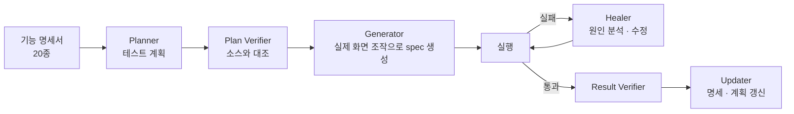

# SRM E2E 테스트 자동화

> 구매 관리(SRM) 앱의 10개 업무 모듈 회귀 테스트를 Playwright로 작성하고, Claude Code 서브에이전트로 계획부터 수정까지 이어지는 테스트 파이프라인을 만들어 207개 시나리오를 모두 통과시켰습니다.

| 항목 | 내용 |
|---|---|
| 기간 | 2026.07 |
| 역할 | SRM 기능 명세 작성, 테스트 계획 · 시나리오 작성, 파이프라인 설계, 안정화 |
| 형태 | 회사 프로젝트 (사내 템플릿 위에서 진행) |
| 기술 | Playwright, Playwright MCP, Claude Code (서브에이전트), TypeScript |

> 회사 프로젝트를 정리한 문서입니다. 테스트 코드, 계정 정보, 화면 기록은 포함하지 않습니다.

## 범위

구매요청 → 구매계획 → 발주 → 계약 → 입고 → 검수 → 송장 → 세금계산서 → 기성 → 비용

## 파이프라인



## 한 일

### 1. 기능 명세부터
- SRM 기능 명세서 20종을 작성하고 실제 메타데이터(오브젝트, 필드, 화면)와 대조해 검증했습니다.
- 시나리오는 추측이 아니라 **앱 소스(LWC, Apex)를 근거**로 작성했습니다.

### 2. 셀렉터 추측 없애기
- 생성 단계에서 AI가 셀렉터를 짐작하지 않도록, **실제로 화면을 조작한 기록**에서 spec을 만들게 했습니다.

### 3. Salesforce 화면 특유의 불안정성
- Lightning 그리드의 지연 렌더링, 겹치는 토스트 메시지 때문에 생기는 간헐 실패를 대기 조건과 닫기 처리로 해결했습니다.
- 로그인 세션을 저장해 매 테스트마다 로그인하지 않게 했습니다.

### 4. 결과
- 테스트 계획 10개, spec 약 210개 작성
- 전체 회귀 실행에서 **207개 spec 모두 통과**
- 도입 효과와 운영 방법을 정리한 보고서 작성

## 예제 코드

테스트 구조와 Lightning 화면 대응 방식을 **독립적으로 다시 구현한 예제**입니다. 회사 코드 · 계정 정보 · 화면 기록은 없습니다.

| 파일 | 역할 |
|---|---|
| [`playwright.config.ts`](playwright.config.ts) | `site` (공개 포트폴리오 사이트) · `salesforce` (로그인 필요) 두 묶음. 로그인은 setup 에서 한 번만 하고 세션을 재사용 |
| [`tests/site/home.spec.ts`](tests/site/home.spec.ts) | 포트폴리오 사이트 회귀 테스트 5개 — 첫 화면, 메뉴 이동, 분류 필터, 카드 펼침, 연락처 |
| [`tests/salesforce/lightning.ts`](tests/salesforce/lightning.ts) | Lightning 헬퍼 — 스피너 대기, 그리드 행 수가 안정될 때까지 대기, 토스트 닫기, combobox 선택 |
| [`tests/salesforce/auth.setup.ts`](tests/salesforce/auth.setup.ts) | 환경 변수로만 로그인, 세션 저장. 계정이 없으면 Salesforce 테스트 전체를 건너뜀 |
| [`tests/salesforce/account-list.spec.ts`](tests/salesforce/account-list.spec.ts) | 표준 Account 예제. 저장 성공을 토스트 문구가 아니라 화면에 남은 값으로 확인 |
| [`plans/`](plans) | 테스트 계획 문서 — 시나리오, 기대 결과, 불안정 요소와 대응 |

### 직접 실행

```bash
npm install
npx playwright install chromium        # 또는 설치된 Edge 사용: PW_CHANNEL=msedge
npx playwright test --project=site

# Salesforce 테스트 (본인 org 계정을 환경 변수로)
SF_LOGIN_URL=https://<your-domain>.my.salesforce.com SF_USERNAME=... SF_PASSWORD=... npx playwright test --project=salesforce
```

사이트 테스트 5개 통과 (2026-10-30, Edge). Salesforce 예제 spec 은 계정 없이 건너뛰는 것까지 확인했고, 실제 org 실행은 각자 계정으로 확인해야 합니다.

## 배운 점

- AI로 테스트를 만들 때 가장 중요한 건 **근거 자료(명세, 소스, 실제 조작 기록)를 먼저 주는 것**이라는 것
